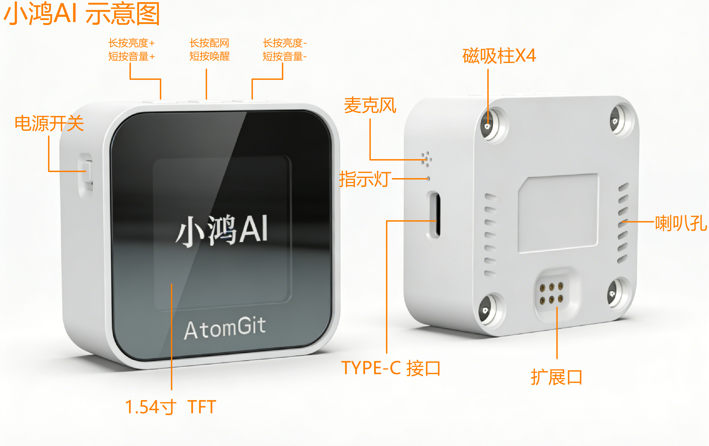
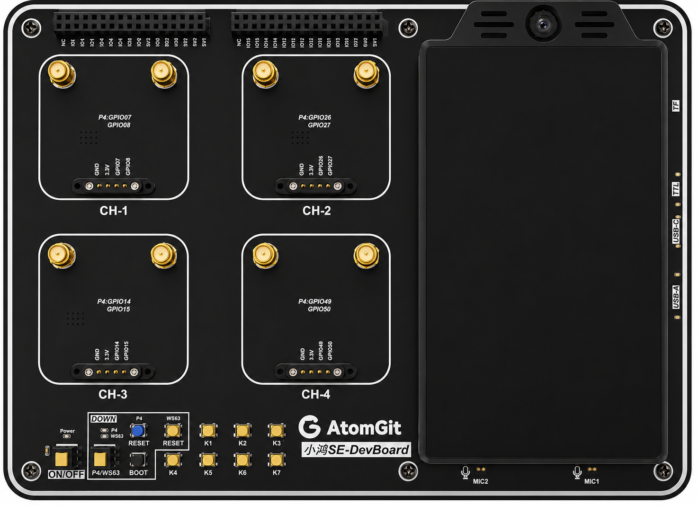

# 项目介绍

小鸿系列产品基于海思 WS63 芯片，采用 RISC-V 架构，搭载开源鸿蒙(OpenHarmony)6.1Release操作系统，以"开源鸿蒙+ RISC-V"双开源为核心，集成星闪(NearLink)无线技术，打造出兼具 AI 在线陪伴与星闪智能家居控制功能的 AI 对话助手，满足家庭用户的双重核心需求，实现"一声唤醒，万物响应"的智能生活体验。

## 小鸿系列产品介绍

### 第一代小鸿（xiaohong）

开源项目名称为：小鸿AI（xiaohong）

主板上只有一颗WS63主控芯片，单芯片单系统。

项目的代码： **xiaohong** 。

开源项目在Atomgit上的链接：[小鸿 AI - 开源代码托管,代码协作 - AtomGit | GitCode](https://atomgit.com/xiaohong-ai)

开源项目在海思官网的案例中心的链接：[AtomGit-WS63 小鸿AI语音|案例中心](https://developers.hisilicon.com/cn/caselibrary/34/xiaohong_ws63aiyuyin)



### 第二代小鸿（xiaohong-se）

开源项目名称为：小鸿SE（xiaohong-se），项目实际由 xiaohong-se + xiaohong-p4 两部分组成。

小鸿SE主板上有两颗芯片：

- 一颗是WS63 星闪/WiFi/BT芯片，开源鸿蒙轻量系统，用于做网络通信并运行AI Agent；

- 一颗是ESP32-P4芯片，开源鸿蒙轻量系统，用于做外设控制、拾音和语音播放、显示屏、摄像头等控制类功能。

两颗芯片之间通过高速串口进行通信和交互。

两颗芯片都适配了开源鸿蒙轻量系统，组成双系统的开发板，须要分别开发/编译/烧录各自的固件。

项目代码分别是：

- **WS63 芯片** 端项目代码： **xiaohong-se**
- **P4 芯片** 端项目代码： **xiaohong-p4**

开源项目在Atomgit上的链接：[小鸿 AI - 开源代码托管,代码协作 - AtomGit | GitCode](https://atomgit.com/xiaohong-ai)




### 小鸿Vibe Coding键盘（xiaohong-kb）

开源项目名称为：小鸿Vibe Coding键盘（xiaohong-kb）【kb：KeyBoard】

小鸿Vibe Coding键盘项目由两部分组成：

- 接收端Dongle(海思BS21E芯片+海思 fbb_bs2x SDK：bs21e 1.0.18)
- 发射端键盘（海思WS63芯片 + OpenHarmony v6.1 + fbb_ws63 SDK v106）

二者通过星闪互联

项目的代码： **xiaohong-kb** 。

开源项目在Atomgit上的链接：[小鸿 AI - 开源代码托管,代码协作 - AtomGit | GitCode](https://atomgit.com/xiaohong-ai)

## 开发环境搭建

开发环境一般建议使用 **Windows主机+Ubuntu虚拟机** 方式（使用Mac主机+Ubuntu虚拟机、纯Ubuntu主机等方式也是可以的，需要开发者自行搭建，并自行解决搭建过程和使用过程中遇到的问题）。

开发环境的搭建可以参考 [docs-代码预览-docs:基于开源鸿蒙与RISC-V的AI对话助手项目 - AtomGit | GitCode](https://atomgit.com/xiaohong-ai/docs/blob/main/开发指南/开发环境搭建.md) 这里的说明进行搭建和使用。

在搭建好Openharmony的开发环境之后，要编译小鸿SE的ESP32-P4芯片端的代码，还需要参考 xiaohong-p4 的[README_CN.md](./xiaohong-p4/README_CN.md) 文档搭建与ESP32相关的开发环境。

## 拉取代码

两代小鸿项目共用一套代码，可以通过如下四个步骤拉取完整的代码。

```
# 步骤一：
# 通过“repo + ssh”方式，拉取基于OH 6.1 版本的代码
repo init -u git@atomgit.com:xiaohong-ai/manifest.git -b OpenHarmony-6.1.0.31-Release -m default_xiaohong.xml -g ohos:mini --no-repo-verify -v

# 或者通过“repo + https”方式，拉取基于OH 6.1 版本的代码
repo init -u https://atomgit.com/xiaohong-ai/manifest.git -b OpenHarmony-6.1.0.31-Release -m default_xiaohong.xml -g ohos:mini --no-repo-verify -v

# 或者通过“repo + https”方式，拉取基于OH 7.0 版本的代码
repo init -u https://atomgit.com/xiaohong-ai/manifest.git -b OpenHarmony-7.0.0.38-Release -m default_xiaohong.xml -g ohos:mini --no-repo-verify -v

# 步骤二：
repo sync -c -j8


# 步骤三：
repo forall -c 'git lfs pull'


# 步骤四：
./build/prebuilts_download.sh

# 注意：步骤四会下载一个大约18G的编译工具链包。小鸿系列项目可以不执行这一步。
# 直接去 https://pan.baidu.com/s/5sVfap2wmaGsovWxKS66tpA 查看README文档，
# 下载一个 prebuilts_for_ohos_x.y_mini_ws63.tar.gz 压缩包到步骤一所下载的OH代码根目录下，
# 执行：tar -xvf prebuilts_for_ohos_x.y_mini_ws63.tar.gz
# x.y 为OH版本对应的工具链版本：6.0、6.1、7.0
# 解压出一个 prebuilts/ 文件夹即可，解压出来的工具链包大约2.4G大小。

# 编译xiaohong-p4（ESP32-P4芯片）项目，需要去 https://pan.baidu.com/s/5sVfap2wmaGsovWxKS66tpA
# 下载一个 toolchains_for_esp32_riscv32-esp-elf.tar.gz 压缩包，将其解压到
# OH代码根目录下的prebuilts目录中或其他目录下，然后编辑 ~/.bashrc 文件，增加如下一行代码：
# export PATH=${你存放riscv32-esp-elf的路径}/riscv32-esp-elf/bin:$PATH
# 保存后退出即可。
# 上述网盘内还有对应的烧录工具，可以一并保存到本地备用。
```

## 编译代码

```
hb set        # 选择 mini，再选择 atomgit 下的项目
OHOS Which os_level do you need?  mini
OHOS Which product do you need?  (Use arrow keys)

atomgit
 ❯ xiaohong
   xiaohong-kb
   xiaohong-p4
   xiaohong-se


# 编译小鸿项目的固件，编译之前，详细阅读下面的注意事项。
hb build -f
```

注意：

> xiaohong 与 其他的xiaohong-se(含独立模块)、xiaohong-kb（接收端）产品，在WS63模块的配置上**有一点差别**，影响编译的是xiaohong-se、xiaohong-kb在ws63这一端没有连接外挂NorFlash，也就没有适配LFS文件系统，需要使用海思SDK自己的文件系统，因此需要做如下两处修改：
>
> - device\soc\hisilicon\ws63v100\sdkv106\build\config\target_config\ws63\menuconfig\acore\ws63_liteos_app.config 文件
>
>   ```
>   CONFIG_MIDDLEWARE_SUPPORT_LFS=y             # 编译 xiaohong-se/kb 或独立模块时，打开这个定义
>   # CONFIG_MIDDLEWARE_SUPPORT_LFS is not set  # 编译 xiaohong 时，关闭这个定义
>   ```
>
> - device\soc\hisilicon\ws63v100\sdkv106\build\config\target_config\ws63\config.py 文件，在 'ws63-liteos-app' 编译目标的 'ram_component' 组件列表中，找到  "littlefs_adapt_ws63"
>
>   ```
>   "little_fs", "littlefs_adapt_ws63",      # 编译 xiaohong-se/kb 或独立模块时，打开这个组件
>   "little_fs", # "littlefs_adapt_ws63",    # 编译 xiaohong 时，注释掉这个组件
>   ```


## 固件路径

```
# 小鸿项目的WS63部分的固件（独立模块的固件也是这个）
//out/xiaohong/xiaohong/ws63-liteos-app/ws63-liteos-app_all.fwpkg
//out/xiaohong/xiaohong-se/ws63-liteos-app/ws63-liteos-app_all.fwpkg
//out/xiaohong/xiaohong-kb/ws63-liteos-app/ws63-liteos-app_all.fwpkg

# 小鸿SE项目ESP32-P4部分的固件
//vendor/atomgit/xiaohong-p4/esp32_app/out/
```

## 烧录固件

以下开源项目的相关硬件，有各自的烧录步骤，请按照下面的文档说明操作烧录。

小鸿AI（xiaohong）的固件烧录说明见：[README_CN.md](./xiaohong/README_CN.md)

小鸿SE（xiaohong-se）的WS63部分（以及独立模块）的固件烧录说明见：[README_CN.md](./xiaohong-se/README_CN.md)

小鸿SE（xiaohong-se）的ESP32-P4部分（xiaohong-p4）的固件烧录说明见：[README_CN.md](./xiaohong-p4/README_CN.md)

小鸿键盘（xiaohong-kb）的发射端和接收端的固件烧录说明见：[README_CN.md](./xiaohong-kb/README_CN.md)

小鸿系列产品的字库使用说明见：[README_CN_how_to_use_font.md](./README_CN_how_to_use_font.md)