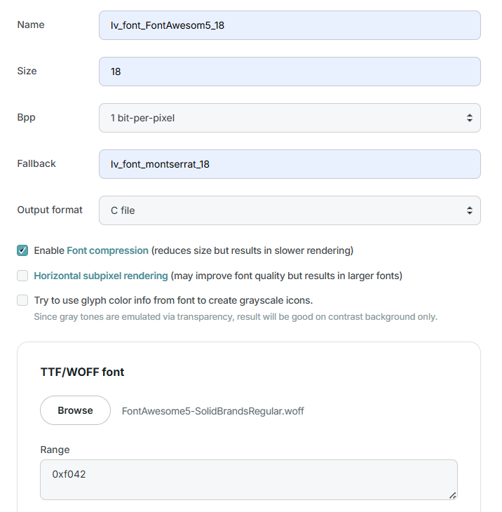
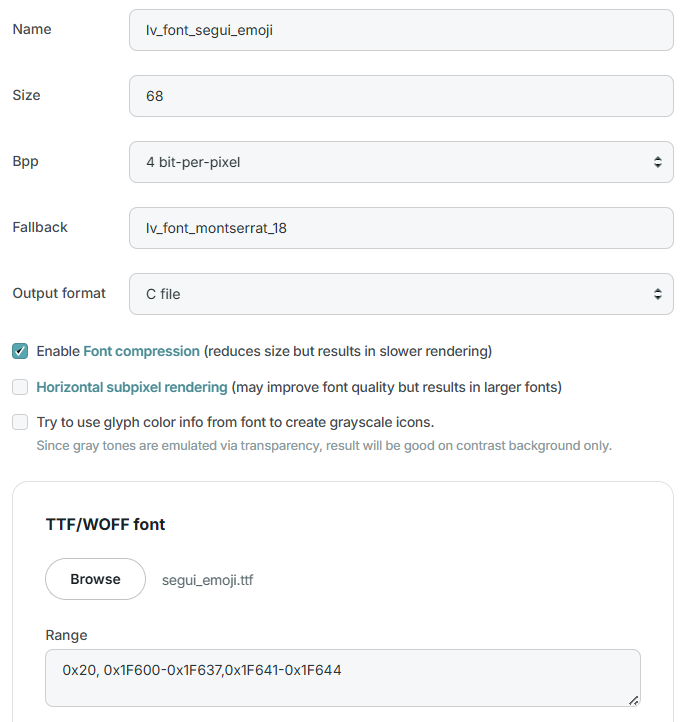
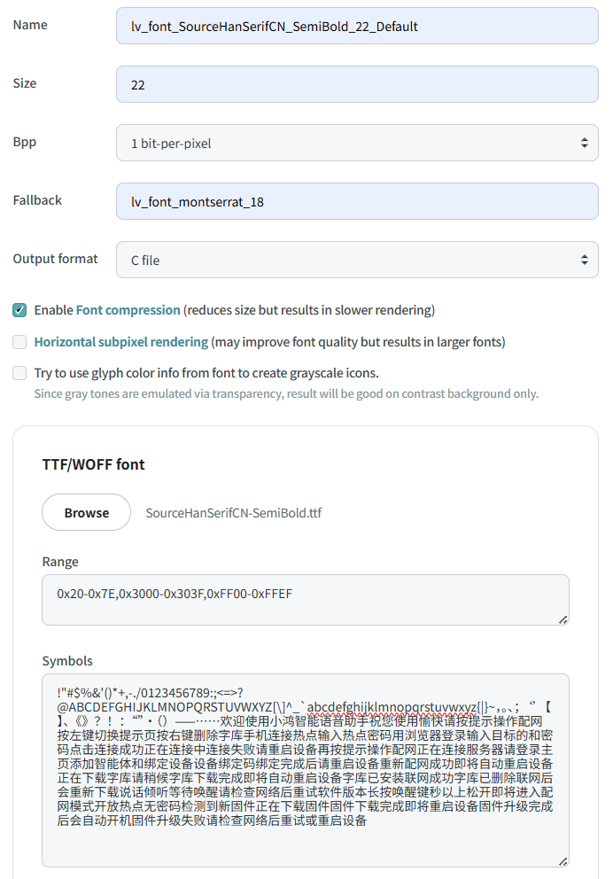
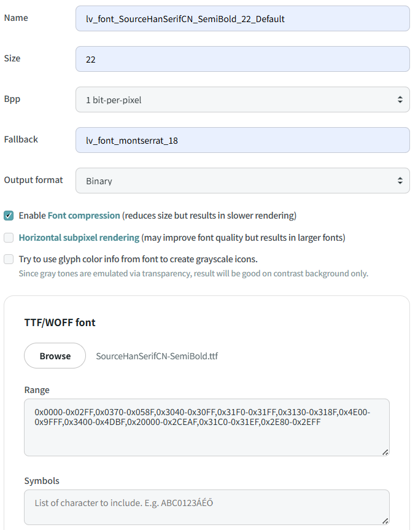
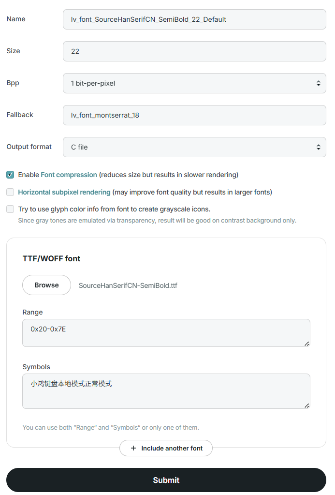

# 字库使用说明

小鸿系列产品默认使用开源的 SourceHanSerifCN_SemiBold 字体，字体文件见：./assets/SourceHanSerifCN-SemiBold.ttf。

其中，小鸿SE默认使用 18号字体；小鸿AI和小鸿KB默认使用 22号字体。

## 小鸿AI

小鸿AI产品的系统内，使用到五个类型的字体，分别是：

1. 系统默认的字体

   lv_font_montserrat_18，该字体用于状态栏上的英文、数字、图标，以及用于其余四种字体的 fallback 配置。

   使用该字体，需要在 lvgl 仓库的 lv_conf.h 文件中打开这个宏，并配置其为默认字体：

   ```
   #define LV_FONT_MONTSERRAT_18 1
   ......
   #define LV_FONT_DEFAULT &lv_font_montserrat_18
   ```

2. 状态栏图标字体

   系统默认的 lv_font_montserrat_18 字体，已从 [FontAwesome](https://fontawesome.com/) 字体中添加了一组符号/图标到内置字体中，使得小鸿的状态栏可以用图标来显示状态，但是默认的图标中没有合适的图标用于表示显示屏亮度（和/或其它一些图标）。

   因此，先从 [FontAwesome](https://fontawesome.com/) 网站上找到一个免费的合适的亮度图标（圆形，半黑半白）0xF042，再获取一个免费的 FontAwesome5-SolidBrandsRegular.woff 字体文件，到 lvgl 的[在线字体转换工具](https://lvgl.io/tools/fontconverter)做如下的配置：

   

   生成一个 lv_font_FontAwesom5_18.c 文件，并配置：

   ```
   #define ST_SYMBOL_BRIGHTNESS      "\xEF\x81\x82"    // 0xf042
   
   LV_FONT_DECLARE(lv_font_FontAwesom5_18);  // 状态栏字体
   ```

   这样就可以直接在状态栏中调用 ST_SYMBOL_BRIGHTNESS 来显示亮度图标了。

   如果还需要其它的图标，可以做类似的操作。

3. emoji 表情图标字体

   对话的emoji表情，如果用彩色图片来显示，则需要在系统内配置多张图片，如果直接编译到固件中，内存会撑爆，这就需要考虑用外挂的图片库，这样又会需要在服务器上部署图标文件并下载到设备的文件系统中，这会增加系统复杂度。

   现改为**直接使用emoji字体**，从emoji字体选几十个表情，编译到固件中使用。

   首先是在网上选合适的开源免费的emoji字体库，这里选中 **segui_emoji.ttf** 字体库（还有其他一些可能更好的字体库如openmoji、noto-emoji，后面可考虑使用它们），到 lvgl 的[在线字体转换工具](https://lvgl.io/tools/fontconverter)做如下的配置：

   

   生成一个 lv_font_segui_emoji.c 文件，并配置 LV_FONT_DECLARE(lv_font_segui_emoji); 之后就可以在UI的表情图标区域直接显示对应的表情文字图标了。

4. UI上系统状态提示相关的文字

   在系统启动过程或者配网等操作中，全屏显示的提示语所使用的文字，是系统自带的一个小型字库，使用的是 SourceHanSerifCN_SemiBold_22号字体，到 lvgl 的在线字体转换工具做如下的配置：

   

   生成一个 lv_font_SourceHanSerifCN_SemiBold_22_Default.c 文件，编译进系统里就可直接显示这里文字了。

5. 对话文字（含多国语言）

   设备在正常工作时，在对话文本窗口显示的文字，需要使用外置的流式字库，仍然是 SourceHanSerifCN_SemiBold_22 号字体，到 lvgl 的在线字体转换工具做如下的配置：

   

   注意，range 的配置，已包含多国语言。

   生成一个 lv_font_SourceHanSerifCN_SemiBold_22_Default.bin 文件，将该文件改名为 font.bin，放到服务器上, 该文件每次有更新，都需要将服务器上对应的版本字段增加一个版本，设备开机后检测到新版本则会自动下载到本地文件系统中，lvgl 会通过流式字库方式进行使用。

## 小鸿SE

小鸿SE开发板的整个UI显示功能，都在ESP32-P4芯片上实现。

P4可以扩展PSRAM内存到32MB，容纳得下小鸿AI所使用到的完整的字库，因此，直接将完整的字库按照小鸿AI第4步的操作将其转换成一个 lv_font_SourceHanSerifCN_SemiBold_18_Default.c 文件，编译进系统里直接使用即可，省去了去下载二进制的字库并使用流式字库的繁琐操作。

## 小鸿KB

小鸿键盘的发射端带显示屏，可以显示状态栏和一组UI交互界面，这些UI界面上使用到的字体分别是：

```
状态栏字体：优先 FontAwesom5_18 字体，默认回退到 SourceHanSerifCN_SemiBold_18，再回退到 lv_font_montserrat_18；

非状态栏的UI界面字体：优先 SourceHanSerifCN_SemiBold_22 字体，默认回退到 lv_font_montserrat_18；
```


### 小鸿键盘配置字体示例

现以将开机首页上的 "小鸿KB"、本地模式页面的 "Local Mode"、正常模式页面的 "Normal Mode" 上显示的英文，全部替换成对应的 "小鸿键盘"、"本地模式"、"正常模式" 汉字为例，演示如何修改并在小鸿键盘页面上显示汉字。

注意：当前系统所使用到的汉字列表，在

#### 步骤一：修改需要显示的英文为汉字

先去对应页面上的代码，将显示英文的地方，修改为对应的中文（注意，源代码文件需要使用UTF-8编码格式），如下：

xiaohong-kb/xiaohong/src/display/lvgl_ui_layout_main_page.c 的 disp_create_main_page () 函数内：

```
//  lv_obj_t *title = disp_create_common_title("小鸿KB");
    lv_obj_t *title = disp_create_common_title("小鸿键盘");
```

xiaohong-kb/xiaohong/src/display/lvgl_ui_layout_local_page.c 的 disp_create_local_page() 函数内：

```
//  lv_obj_t *title = disp_create_common_title("Local Mode");
    lv_obj_t *title = disp_create_common_title("本地模式");
```

xiaohong-kb/xiaohong/src/display/lvgl_ui_layout_normal_page.c 的 disp_create_normal_page() 函数内：

```
//  lv_obj_t *title = disp_create_common_title("Normal Mode");
    lv_obj_t *title = disp_create_common_title("正常模式");
```

#### 步骤二：收集需要显示的汉字列表

收集对应的汉字(包括需要显示的标点符号等)： "小鸿键盘本地模式正常模式"，记录下来；去掉重复的汉字/标点，或不去掉重复的汉字/标点，都可以。

```
/* UI 汉字列表：*/
/* 小鸿键盘本地模式正常模式 */

只转换上面这些汉字到代码中，也就只有这些汉字能正常显示出来，其余未在其中的汉字如 "配置"，则会显示一个空的方块；
如果再增加 "配置" 到上面列表中，则 "配置" 汉字也能正常显示出来。
```

#### 步骤三：将汉字列表转换成源代码文件

参考小鸿AI上面提到的 "UI上系统状态提示相关的文字" 的说明，先登录 lvgl 的[在线字体转换工具](https://lvgl.io/tools/fontconverter) 页面，做如下的配置：



- 在 Name 标签下输入 "lv_font_SourceHanSerifCN_SemiBold_22_Default" 名字，这是将指定的文字按指定的字体文件生成的 .c 文件的名字，该文件会以源代码的编译到固件中被使用。

- 在 Size 标签下输入需要的字号，小鸿键盘默认使用22号字体；

- 在 Bpp 标签下选择 "1bit-per-pixel";

- 在 Fallback 标签下输入 "lv_font_montserrat_18"，当使用到 "lv_font_SourceHanSerifCN_SemiBold_22_Default.c" 中不存在的文字时（如 "星闪"），lvgl 会默认回退到系统默认的 "lv_font_montserrat_18" 字体中寻找该文字，找到就使用，没找到就显示空白方块。

- 在 Output format 标签下选择 "C file"，选择生成 "lv_font_SourceHanSerifCN_SemiBold_22_Default.c" 文件。

- 勾选 "Enable Font compression" 选项；

- 在 FTT/WOFF font 下的 "Browse" 按钮，选中本仓库的 ./assets/fonts/SourceHanSerifCN-SemiBold.ttf 文件并上传；

- 在 Range 框输入 "0x20-0x7E"，这是可显示的ASCII编码字符的范围；在 Symbols 框输入上面收集到的 汉字列表 "小鸿键盘本地模式正常模式" ; 也可继续添加CJK标点和全角标点等：0x20-0x7E,0x3000-0x303F,0xFF00-0xFFEF

- 点击 Submit 按钮，提示字体转换成功，并自动下载一个 "lv_font_SourceHanSerifCN_SemiBold_22_Default.c" 文件；

- 打开该文件可以看到文件头部：

  ```
  /*******************************************************************************
   * Size: 22 px
   * Bpp: 1
   * Opts: --bpp 1 --size 22 --stride 1 --align 1 --font SourceHanSerifCN-SemiBold.ttf --symbols 小鸿键盘本地模式正常模式 --range 32-126 --format lvgl -o lv_font_SourceHanSerifCN_SemiBold_22_Default.c
   ******************************************************************************/
  ```

   这就是转换出来的字体源代码文件的具体参数，接下来的 glyph_bitmap 数组就是已转换的字符列表的位图，以及当前字体的具体信息。

#### 步骤四：替换字体源代码文件

将上面下载到的 "lv_font_SourceHanSerifCN_SemiBold_22_Default.c" 文件，直接替换掉项目的  xiaohong-kb/xiaohong/src/display/lvgl/ 目录下的同名文件。

#### 步骤五：编译烧录固件验证效果

经过上面的处理后，重新编译固件，烧录固件到键盘中，重启后即可看到小鸿键盘的开机首页上的 "小鸿KB"、本地模式页面的 "Local Mode"、正常模式页面的 "Normal Mode" 上显示的英文，已经全部正常显示为对应的 "小鸿键盘"、"本地模式"、"正常模式" 汉字。

其他页面或交互信息中，需要显示的汉字，直接收集完整的汉字列表，替换到步骤三中的Symbols中，再重新操作即可。

