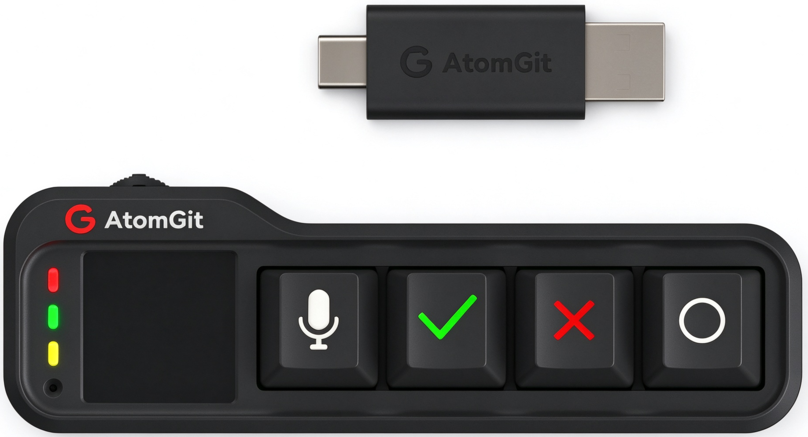

# 小鸿键盘使用指南

清单：USB数据线、键盘接收端(Dongle）、键盘本体（键盘发射端）

---

## 1. 认识你的键盘

键盘接收端(Dongle）：直接插入 PC 的 Type-A 或 Type-C 口，PC 会识别到一个 USB 输入设备（AtomGit-KB）。

键盘本体正面有四个物理按键，侧面有一个三向拨码键：

| 部位 | 名称 | 说明 |
|---|---|---|
| 正面 | （麦克风键） | 语音输入快捷键【左Ctrl+左Win的组合键】                       |
| 正面 | ✔ 键 | 确认【Enter】 |
| 正面 | ❌️键 | 取消【ESC】 |
| 正面 | **O** 键 | 功能键【字母 'a' 键】，可与其他键组成组合键 |
| 侧面 | 三向拨码键 | 三键合一：向左【上一页】 / 按下 【开关机】/ 向右【下一页】，用于翻页和开关机 |

键盘顶部有一块显示屏，显示工作状态、连接状态和操作提示；键盘侧边有 Type-C 接口，用于充电和烧录固件。

## 2. 开机与关机

- **开机**：三向拨码键持续按下 1 秒后松开。
- **关机**：三向拨码键持续按下 3 秒后松开。
- **复位（重启）**：同时按下 **O 键 +  ****键** 后松开（建议先按 **O 键**，再按 **键**）。
  
  > ⚠️ 不要先按 **键**再按 **O 键**，否则可能会先把 PC 端语音输入法拉起且无法自动关闭。

## 3. 连接 PC（接收端 Dongle）

键盘是"发射端"，随机附带的 Dongle 是"接收端"。Dongle 插入 PC 后，PC 会识别到一个 USB 输入设备（AtomGit-KB）。

### 3.1 首次配对步骤

1. 将 Dongle 插入 PC 的 USB 口；
2. 键盘开机后，会**自动扫描**周边可用的 Dongle，并在显示屏上列出扫描到的 Mac 地址；可以按 "**❌️ 键**" 或 "**O 键 + ❌️键**" 组合键刷新扫描结果；
3. 用侧面的 **向左/向右键** 上下移动光标，选中要连接的 Dongle（可在 PC "设备管理器 → USB输入设备 → 事件" 中查看 Dongle 的序列号/Mac 地址来确认对应关系）；
4. 按 "**✔ 键**" 或 "**O 键 + ✔键**" 组合键进行连接；
5. 连接成功后会返回主页面，屏幕底部显示已连接的 Dongle 的 Mac 地址，Dongle 上的状态指示灯由闪烁变为**常亮**。

配对关系会保存在键盘中，**下次开机自动连接**上次配对的 Dongle，无需重新配对。

### 3.2 断开与重新配对

按 "**O 键 + ❌️键**" 组合键可断开当前连接，重新进入扫描配对流程；扫描的过程中，可以按 "**❌️ 键**" 或 "**O 键 + ❌️键**" 组合键刷新扫描结果。

## 4. 日常按键使用（已连接 Dongle）

连接配对成功后（正常工作模式），各按键的默认功能：

| 按键 | 功能（作用于 PC 当前焦点窗口） |
|---|---|
| 向左键 | PageUp（向上翻页） |
| 向右键 | PageDown（向下翻页） |
|  键 | **按住说话**：按下后触发 PC 端语音输入（如语音输入法），持续按住并说话，语音被转成文字输入到焦点窗口，松开即停止语音输入 |
| ✔ 键 | Enter（回车确认） |
| ❌️ 键 | ESC（取消/退出） |
| O 键 | 字母 a |
| O 键 + ❌️键 | 断开连接，重新配对 |
| O 键 + 向左键 | 切换工作模式（正常模式 / 本地模式） |
| O 键 + 向右键 | 切换按键码映射模式（Default / Custom） |

> ⚠️ 不要先按 **键**再按 **O 键**，否则可能会先把 PC 端语音输入法拉起且无法自动关闭。

### 4.1 语音输入典型用法

1. 在 PC 上把光标点到要输入文字的输入框；
2. **按住**键盘上的  键不放；
3. 对着 PC 的麦克风说话；
4. 说完后**松开**  键，识别的文字即输入到 PC。

## 5. 两种工作模式

通过 "**O 键 + 向左键**" 循环切换：

- **模式 0：正常工作模式（默认）**——单键消息发送给 Dongle 由 PC 处理；组合键在键盘本地处理。
- **模式 1：本地工作模式**——所有按键消息都在键盘本地处理，不发往 Dongle，用于在键盘本机屏幕上进行设置等操作。

> 未连接 Dongle 时，键盘自动按模式 1 处理。

## 6. 自定义键位（可选进阶）

无需烧录固件，通过浏览器网页即可自定义各按键发送的键值（单键/组合键/最多 6 步宏）：

1. 按 "**O 键 + 向左键**" 切换到本地工作模式；
2. 用向左/向右键高亮选中 "**按键映射**" 按钮，按 ✔ 键进入配置引导页，此时键盘开启热点 **XH-KB_xxxx**（无密码）；
3. 用手机或 PC 连接该热点，浏览器访问 **http://192.168.1.1**（注意是 http 不是 https）；
4. 在网页上为各键位配置按键序列（每键最多 6 步，每步可选 Ctrl/Shift/Alt/Win 等修饰键 + 一个按键）；
5. 点击"**保存配置**"立即生效（掉电不丢失）；点"**恢复默认**"可还原出厂设置；
6. 再次按 "**O 键 + 向右键**" 退出配置模式，回到正常工作模式。

> 注意：
> - 自定义映射只在**已连接 Dongle 且正常工作模式（模式 0）**下生效，且需按 "**O 键 + 向右键**" 切换到 Custom（自定义）映射模式；
> - "**O 键 + 向左键**" 和 "**O 键 + 向右键**" 两个组合键被系统占用，不能自定义，否则无法切换模式。

配置示例：❌ 键发 ESC、O 键发 Ctrl+C、✔ 键发 Win+V 等，更详细的使用说明见官方开源代码仓库的 [README_CN_custom_keyboard.md](./README_CN_custom_keyboard.md) 文档。

## 7. 常见问题（FAQ）

**Q1：键盘开机后连不上 Dongle？**
- 确认 Dongle 已插入 PC 且指示灯在闪烁（闪烁表示等待配对，常亮表示已连接）；
- 按 "O 键 + ❌️键" 重新进入配对流程，选择正确的 Mac 地址连接。

**Q2：按键没有反应 / 按键功能不对？**
- 检查工作模式：按 "O 键 + 向左键" 切换回正常模式（模式 0）；
- 检查映射模式：按 "O 键 + 向右键" 在 Default/Custom 之间切换，若误配置了自定义键位，可在配置页面点"恢复默认"。

**Q3：浏览器打不开 192.168.1.1？**

- 确认已连接键盘热点 XH-KB_xxxx；地址必须是 `http://` 开头；
- 确认键盘屏幕仍停留在"按键重映射"提示页，否则重新进入配置模式。

**Q4：重新烧录固件后，配对信息和自定义键位会丢吗？**

- 这些信息保存在芯片 NV 区域。烧录键盘固件时**不要勾选烧录 `ws63_all_nv.bin`**，即可保留。

**Q5：误触发了复位，PC 语音输入法一直开着？**

- 复位组合键应**先按 O 键再按 键**。若语音输入法被卡住，在 PC 上手动关闭即可。

## 8. 更多资料

可以登录官方的[开源代码仓库](https://atomgit.com/xiaohong-ai/vendor_atomgit/tree/OpenHarmony-7.0.0.38-Release/xiaohong-kb)：https://atomgit.com/xiaohong-ai/vendor_atomgit/tree/OpenHarmony-7.0.0.38-Release/xiaohong-kb 或扫描下面二维码：

阅读以下文档做进一步了解。

| 文档 | 内容 |
|---|---|
| [README_CN.md](./README_CN.md) | 按键定义全表、固件烧录、配对原理 |
| [README_CN_custom_keyboard.md](./README_CN_custom_keyboard.md) | 自定义键位完整教程与配置示例 |
| [HB_BUILD_DEBUG_GUIDE.md](./HB_BUILD_DEBUG_GUIDE.md) | 开发者向：构建失败排查指南 |
