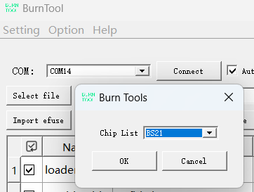
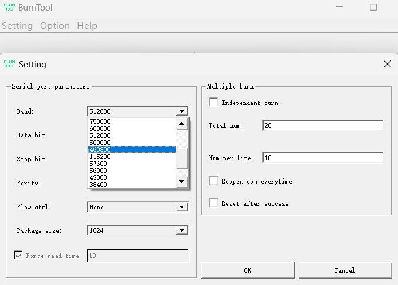
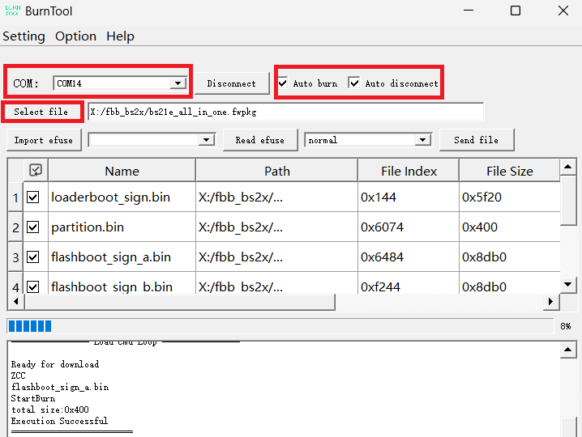
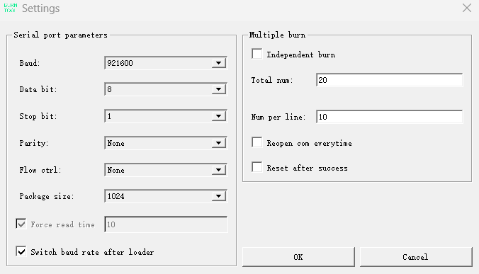
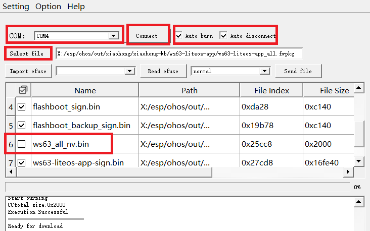
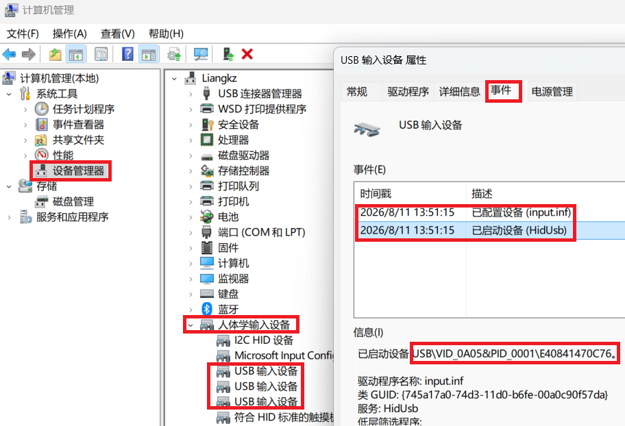

# 小鸿键盘 (xiaohong-kb)

## 项目介绍

开发环境的搭建、拉取代码、编译项目代码的详细步骤，见：[README_CN.md](../README_CN.md)

## 按键定义

- 键盘正面四个物理按键：🎤（麦克风)、✅️、❌️、**O**；

- 键盘侧面一个三向拨码键：向左、按下、向右

  > **组合键，注意**：
  >
  > 硬件上，🎤（麦克风)键是一个独立按键（GPIO口）；**O** 键也是一个独立按键（GPIO口）；
  >
  > 而 ✅️、❌️、**三向拨码键** 这三个是通过一个共同的IO口以ADC方式区分的一个独立按键（GPIO口）。
  >
  > **因此**：
  >
  > - ✅️、❌️、三向拨码键的向左键、三向拨码键的向右键，这四个键无法两两组成组合键；这四个按键如有组合按下时，先松开的按键会被忽略，最后松开的按键会被检测和识别。
  > - 🎤（麦克风)键，需要保持长按以便触发PC端拾音和语音转文字，默认不会与其他键组成组合键，除了一个：🎤（麦克风)键 与 **O** 键 的组合键，触发系统复位。
  > - **O** 键与四个键（✅️、❌️、三向拨码键的向左键、三向拨码键的向右键）可以组成组合键（**组合键的两个按键，按下的顺序不重要，松开的顺序也不重要**）。

**1. 系统功能键**

- 开机：三向拨码键持续按下1秒钟后松开

- 关机：三向拨码键持续按下3秒钟后松开

- 复位：**同时按下 O 键与🎤（麦克风) 键【建议先按下O键再按下🎤键】**后松开，系统复位，主要用于烧录固件，或快速重启。

              如果先按下🎤键，此时可能会先发送按键消息到PC拉起PC的语音输入法了，再去按下O键，触发复位，此时PC上的语音输入法会持续开启，没法自动关闭。

**2. 工作模式**

发射端与接收端连接配对后，通过 "**O** 键 + 向左键" 的组合键，循环切换以下两种工作模式：

- 模式0：正常工作模式（默认），发射端与接收端连接配对后，几个单键的消息，会发送给Dongle，不在本地处理；组合键的消息，则会在本地处理，不发给Dongle；发射端与接收端断开连接后，默认按**模式1**处理。
- 模式1：本地工作模式，**所有单键/组合键消息，都留在本地处理，不再发送给Dongle**，全部按键功能与未连接配对时保持一致。

**3. 按键码映射模式**

发射端与接收端连接配对后，通过 "**O** 键 + 向右键" 的组合键，循环切换以下两种按键码映射模式：

- 模式0：**系统默认按键码模式**（顶部状态栏中间显示 "Default"），发射端与接收端连接配对后，在正常工作模式下，按下键盘上的几个按键，会发送**系统默认的按键码**到Dongle进行处理。
- 模式1：**用户自定义按键码模式**（顶部状态栏中间显示 "Custom"），发射端与接收端连接配对后，在正常工作模式下，按下键盘上的几个按键，会发送**用户自定义的按键码**到Dongle进行处理。

注意：用户自定义按键码的操作步骤见下面的 “浏览器配置自定义键位” 章节。

**4. 发射端键盘与接收端 Dongle 未连接配对**

当发射端键盘与接收端 Dongle **断开连接（未连接配对）** 时，各按键功能定义如下：

1. **三向拨码键的向左键**：按下后松开该键，高亮选项移动到上一项

2. **三向拨码键的向右键**：按下后松开该键，高亮选项移动到下一项

3. 🎤（麦克风) 键：显示本地工作模式页面（提供设置功能相关的入口）

4. ✅️键：**选中高亮的选项【同 O 键 + ✅️ 的组合键】**

5. ❌️键：刷新当前显示的页面

6. **O** 键：

7. **O** 键 + 向左键：**在两种工作模式间切换：0/1**【该组合键不允许自定义】

8. **O** 键 + 向右键：**在两种按键码映射模式间切换：0/1**【该组合键不允许自定义】

9. **O** 键 + ✅️：**选中高亮的选项**

   在【配对页面】连接/配对高亮选项指定的Dongle，连接上Dongle后，按键功能自动切换为已连接配对时的按键功能。

10. **O** 键 + ❌️：【**禁止使用**，确保与已配对情况下的 "**O** 键 + ✅️" 组合键的功能形成明确的对应关系，避免引起按键功能混乱的困扰】


**5. 发射端键盘与接收端Dongle 已连接配对**

当发射端键盘与接收端Dongle**连接且配对成功**时，在工作模式0（正常模式）下，各按键功能定义如下（在工作模式1/本地模式下的按键功能定义见 "未连接配对" 时的功能定义）：

1. **三向拨码键的向左键**：按下后松开该键，向接收端发送 "PageUp键"，触发PC端在焦点所在窗口执行 "PageUp键" 对应的功能。

2. **三向拨码键的向右键**：按下后松开该键，向接收端发送 "PageDown键"，触发PC端在焦点所在窗口执行 "PageDown键" 对应的功能。

3. 🎤（麦克风) 键：**按下时**，向接收端发送 "左Ctrl键"+"左Gui键（Windows键）"的组合按键 ，触发调起PC端匹配该快捷键的语音输入功能（比如微信的语音输入法）；**持续按下该键**，并对PC的麦克风说话，PC的语音输入法识别对应的语音，转化成文字，输入到焦点所在窗口；**松开该键**，向接收端发送 "释放按键/松开按键" ，触发停止语音输入。

4. ✅️键：**按下后松开该键**，向接收端发送 "Enter键"，触发PC端在焦点所在窗口执行 "Enter键" 对应的功能。

5. ❌️键：**按下后松开该键**，向接收端发送 "ESC键"，触发PC端在焦点所在窗口执行 "ESC键" 对应的功能。

6. **O** 键：**按下后松开该键**，向接收端发送 "字母a键"，触发PC端在焦点所在窗口执行 "字母a键" 对应的功能。

   ==== 以下几个组合键是连接配对后，会在本地处理的按键消息，不发送到Dongle ====

7. **O** 键 + 向左键：**在两种工作模式间切换：0/1**【该组合键不允许自定义】

8. **O** 键 + 向右键：**在两种按键码映射模式间切换：0/1**【该组合键不允许自定义】

9. **O** 键 + ✅️：【**禁止使用**，确保与已配对情况下的 "**O** 键 + ❌️" 组合键的功能形成明确的对应关系，避免引起按键功能混乱的困扰】

10. **O** 键 + ❌️：**断开与接收端Dongle的连接，重新扫描周边的可连接Dongle，进入重新配对流程；按键功能自动切换为未连接配对时的按键功能。**


## 编译代码


## 固件路径

小鸿键盘的固件分为两部分：**键盘端（发射端）的WS63的固件**、**接收端（Dongle）的BS21E的固件**。

```
# 键盘端WS63的固件（编译产物）
//out/xiaohong/xiaohong-kb/ws63-liteos-app/ws63-liteos-app_all.fwpkg

# 键盘端WS63与接收端Dongle BS21E的发布固件包（按版本存放）
# 见：xiaohong-kb/xiaohong/fw/ 目录下的 README.md
xiaohong-kb/xiaohong/fw/xh-kb-v1.0.0_20260730/xiaohong_kb_ws63.fwpkg
xiaohong-kb/xiaohong/fw/xh-kb-v1.0.0_20260730/xiaohong_kb_bs21e_dongle.fwpkg
```

> 其中 `xiaohong_kb_ws63.fwpkg` 是键盘端WS63的固件，`xiaohong_kb_bs21e_dongle.fwpkg` 是接收端Dongle BS21E的固件。

## 烧录固件

小鸿键盘的固件分为两部分：**接收端（Dongle）的BS21E的固件**、**发送端（键盘）的WS63的固件**。

### 烧录接收端（Dongle）的BS21E的固件

接收端（Dongle）的USB口，用于供电以及接入PC模拟一个USB键盘，并不能用于烧录固件和调试接收端（Dongle）。

要调试和烧录接收端（Dongle）的固件，需要先对接收端板子做一下处理。查看开发板电路板上引出的6个信号线：其中 RESET 和 GND 短接一下，会触发接收端复位，用于触发烧录固件；烧录固件用的串口信号四个（GND、RX、TX、3V3），将前三个信号接入串口调试工具，再接入到PC，PC会识别到一个COM口设备。

打开海思的官方烧录工具，在工具栏的 "Option" 的 "Change chip" 下拉选项中，选择 "BS21"; 



在工具栏的 "Setting" 的 "Settings" 选项卡中，**设置串口的 Baud 的波特率参数为 "460800" 或 "115200"**（设置为 "500000" 或更高的波特率实测不一定能烧录成功）：



设置好之后，在烧录工具主界面选择接收端（Dongle）对应的COM口，勾选"Auto burn" 和 "Auto disconnect"，选择待烧录的固件，确认都无误，点击 "Connect" 按键，然后短接一下电路板上的 RESET 和 GND 两个信号，触发复位和固件烧录：



烧录完成会自动重启。

重启后PC会自动识别到一个USB键盘，点击确认连接到PC即可。

### 烧录发送端（键盘）的WS63的固件

通过Type-C数据线连接键盘与PC，PC端会识别到一个串口。

打开海思的官方烧录工具，在工具栏的 "Option" 的 "Change chip" 下拉选项中，选择 "WS63"；


在工具栏的 "Setting" 的 "Settings" 选项卡中，设置串口的 Baud 的波特率参数为 "921600" （设置为更低的波特率也是可以烧录成功的，不过烧录速度较慢）：



设置好之后，在烧录工具主界面选择发射端（键盘）对应的COM口，勾选"Auto burn" 和 "Auto disconnect"，选择待烧录的固件，确认都无误，点击 "Connect" 按键，然后同时按下键盘上的 "MIC（麦克风键）" 和 "O" 两个按键后松开，触发复位和固件烧录：

> **注意**：键盘的一些用户自定义信息（如上一次配对的接收端的Mac地址、自定义的快捷键等）会保存在芯片的NV区域，勾选烧录 "ws63_all_nv.bin" 会导致这些信息被刷新而丢失，建议不勾选烧录该nv区域，可保证自定义的信息不会丢失。



烧录完成会自动重启。

键盘重启后，要么自动连接上次配对的接收端，要么进入配对模式，需要根据显示屏上的提示操作配对连接接收端，配对成功后可正常使用键盘。

## 设备配对使用说明

### 接收端

小鸿键盘的接收端接入PC（以Windows系统为例）后，PC检测到一个USB的输入设备（AtomGit-KB）接入。

右键打开 "我的电脑" -> "设备管理器"，如下图所示，在 "人体学输入设备" 的 "USB输入设备" 列表中，打开属性，打开 "事件" 标签，查看设备信息，如下一段信息 **"USB\VID_0A05&PID_0001\E40841470C76"**，这里的 **"VID_0A05&PID_0001"** 就是小鸿键盘接收端的 vendor id 和 product id，**"E40841470C76"** 则是小鸿键盘接收端的序列号，也是 Mac 地址，以 **E4:08:41:47:0C:76** 的形式被键盘发设备端搜索到，并显示到显示屏上。

小鸿键盘接收端没有配对的发射端连接上的时候，状态指示灯会闪烁；有配对的发射端连接上时，状态指示灯会常亮。



### 发射端

小鸿键盘的发射端，开机后会自动扫描周边的可用的小鸿接收端，并将扫描到的接收端 Mac 地址以列表的形式显示在显示屏上；

可以通过发射端右侧的上下方向键进行选择，然后按下 "**O** 键 + ✅️" 组合键进行连接；连接成功后会返回主页面，在显示屏底部显示已连接上的接收端的Mac地址；同时将该Mac地址保存到系统的nv区域，下次系统启动时，将直接去连接该Mac地址的接收端。

小鸿键盘发射端在连接上接收端之后，可以按下 "**O** 键 + ❌️" 组合键，断开与当前的接收端的连接，重新进入扫描和配对流程，显示屏显示当前扫描到的待配对的接收端Mac地址，再通过发射端右侧的上下方向键进行选择，按下 "**O** 键 + ✅️" 组合键进行连接。

因此， "**O** 键 + ❌️" 组合键和 "**O** 键 + ✅️" 组合键，分别是用来断开当前连接和选择启动新的连接使用的。

其余单键或组合键，在具体情况下的按键功能，详情见上面 “按键定义” 小节的说明。

## 浏览器配置自定义键位

小鸿键盘支持通过 **浏览器网页** 自定义各物理键（单键/组合键/多键宏）的按键映射，无需重新烧录固件。

### 进入配置模式

先下按 "**O** 键 + 向左键" 组合键，切换进入本地工作模式；

再按 "向左键" 或 "向右键" 移动光标高亮选中本地模式页面下的 "按键映射" 按钮，按 ✅️ 键，进入 "按键重映射" 操作指导页面（此时系统会开启一个名为 "XH-KB_xxxx" 的热点）；

再根据指导页面的说明进行操作（通过 "向左键" 和 "向右键" 查看完整的操作步骤）：

1. 用手机或PC连接热点 "XH-KB_xxxx" （开放热点，无需输入密码） 
2. 再打开浏览器访问页面：http://192.168.1.1
3. 在打开的自定义键位页面上，为多个按键配置按键映射的操作步骤和对应的按键
4. 配置完成后选择 "保存配置" 或 "恢复默认"，新配置的键位映射会立即生效
5. 手机/电脑连接键盘开启的 WiFi 热点 **`Xiaohong_KB`**（开放热点，无密码）；
6. 浏览器打开 **http://192.168.1.1** ，即可进入键位配置页面；
7. 配置完成后，再次按下 **O 键 + 向右键** 退出配置模式。

### 配置项说明

- 可配置键位：O 键、❌ 键、✅ 键、上键、下键 五个单键，以及 O+❌、O+✅ 两个组合键；
- 每个键位不配置按键序列（宏）时（即步骤数为 0 时），该键使用系统默认的按键码；
- 每个键位可配置最多 6 步的按键序列（宏），每步可选修饰键（Ctrl/Shift/Alt/Win 及右修饰键）和一个按键；
- 点击 **保存配置** 立即生效（保存在芯片 NV 区域，掉电不丢失）；点击 **恢复默认** 还原为出厂映射；
- 自定义映射仅在 **已连接 Dongle 且为正常工作模式（模式0）** 时生效；未自定义的键位保持原有功能不变。

> 注意： 以下两个组合键已经被系统占用，用于在任何情况下都可以切换：
>
> 1. 切换键盘的工作模式(Always_Up、**O 键 + 向左键**  )：  0-正常工作模式(按键码发往Dongle)，1-本地工作模式(按键码不发往Dongle)
>
> 2. 切换按键的映射模式(Always_Down、**O 键 + 向右键**)：0-使用系统默认的按键编码，1-使用用户自定义的按键编码
>
> 因此，这两个组合键，用户不能修改默认功能，否则将无法正常切换上述两个模式的功能。

详细的配网与自定义键盘使用教程见：[README_CN_custom_keyboard.md](./README_CN_custom_keyboard.md)