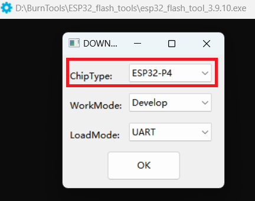
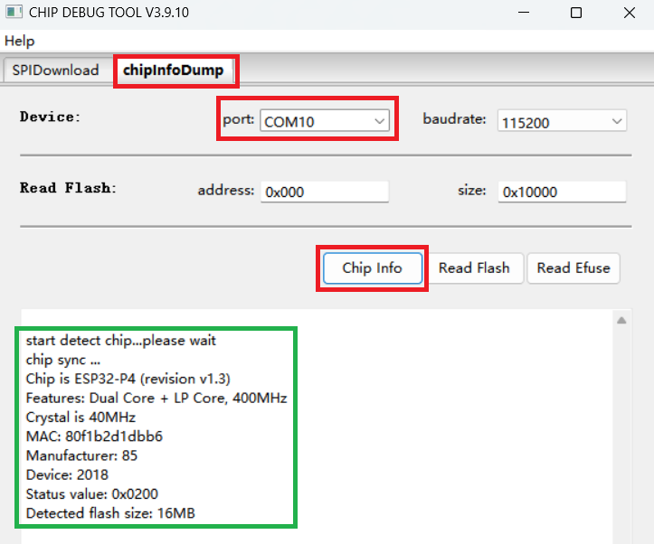
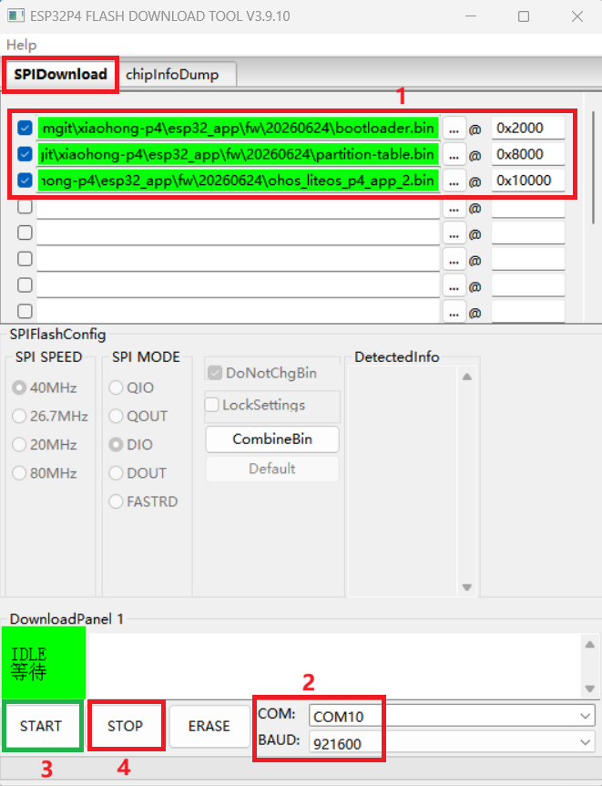
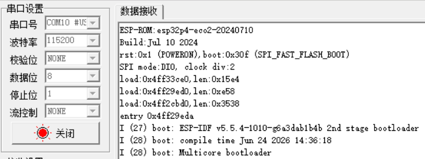

# 小鸿SE (xiaohong-p4)

## 项目介绍

开发环境的搭建、拉取代码、编译项目代码的详细步骤，见：[README_CN.md](../README_CN.md)

**注意：**

> 小鸿SE开发板上右端的 "TTL" 丝印下方的Type-C口，是用于开发板供电、调试和烧录固件用的，并且是板上的ESP32-P4芯片和WS63芯片复用的，可以通过开发板左下角的 "P4/WS63" 按键进行切换：
>
> "P4/WS63" 按键弹起：点亮上方的P4蓝色指示灯，表示当前"TTL"  Type-C口连接ESP32-P4芯片，可以对ESP32-P4芯片进行调试和烧录固件。
>
> "P4/WS63" 按键压下：点亮上方的WS63蓝色指示灯，表示当前"TTL"  Type-C口连接WS63芯片，可以对WS63芯片进行调试和烧录固件。


## 搭建编译环境

虽然ESP32-P4芯片已经适配了OpenHarmony系统，但是编译这部分代码还是需要依赖 ESP-IDF 环境，因此需要在搭建好的OpenHarmony 开发环境（以 Windows主机+Ubuntu虚拟机为例）中配置 ESP-IDF 环境。

> 注意：
>
> ESP-IDF 环境需要依赖一组库，这些库可能在搭建OpenHarmony的开发环境阶段已经安装上去了，如果后面步骤提示缺失工具，可以直接执行 sudo apt install -y  xxx 命令安装上去即可。
>
> 依赖的库包括：
>
> curl    build-essential    libbz2-dev    libreadline-dev    libsqlite3-dev    libffi-dev    liblzma-dev    tk-dev    xz-utils    zlib1g-dev    git    wget    flex    bison    gperf    cmake    ninja-build    ccache    libssl-dev    dfu-util    libusb-1.0-0

### Python版本

ESP-IDF 需要 Python 3.10 版本。

虚拟机的 Ubuntu如果是 22.04 及以上版本，默认安装的是Python 3.10版本，可以跳过这个步骤；

如果使用Ubuntu 22.04 以下的版本，Python 低于 3.10 ，则要么升级到3.10版本，要么通过 pyenv 单独安装一个 Python 3.10 版本给 ESP-IDF 使用。

1. 安装 pyenv

   执行 pyenv 安装脚本：

   ```bash
   curl https://pyenv.run | bash
   ```

   pyenv 默认安装到 `~/.pyenv/` 目录下，安装完成后，把 pyenv 环境变量写入 `~/.bashrc`：

   ```bash
   cat >> ~/.bashrc << 'EOF'
   
   # pyenv
   export PYENV_ROOT="$HOME/.pyenv"
   [[ -d $PYENV_ROOT/bin ]] && export PATH="$PYENV_ROOT/bin:$PATH"
   eval "$(pyenv init -)"
   EOF
   ```

   让配置立即生效：

   ```bash
   source ~/.bashrc
   ```

   检查 pyenv 是否安装成功：

   ```bash
   pyenv --version
   ```

   如果能输出 pyenv 版本号，说明 pyenv 已经可以使用。

2. 安装 Python 3.10

   使用 pyenv 安装 Python 3.10。这里建议使用 3.10.13：

   ```bash
   pyenv install 3.10.13
   ```

   这个过程会从源码编译 Python，需要等待一段时间。

   安装完成后检查：

   ```bash
   ~/.pyenv/versions/3.10.13/bin/python --version
   ```

   正常输出：

   ```text
   Python 3.10.13
   ```

### 拉取 ESP-IDF 代码

建议把 ESP-IDF 的代码放到一个单独目录下（例如：~/esp/ 目录下），避免与OpenHarmony系统代码混在一起。

从 Espressif 官方仓库拉取 ESP-IDF 源码（建议拉取 5.4 及以上版本，下面以拉取 5.5 版本为例），并同步子模块：

```bash
mkdir -p ~/esp
cd ~/esp

git clone -b release/v5.5 --recursive https://github.com/espressif/esp-idf.git
# 这里的 -b 参数也可以换成 tags 下的 v5.4.x 或 v5.5.x
# 如果 github 下载不了或速度太慢，可以换成从如下仓库拉取:
# https://atomgit.com/GitHub_Trending/es/esp-idf.git
# https://atomgit.com/xiaohong-ai/esp-idf.git 
# https://gitee.com/EspressifSystems/esp-idf.git

cd ~/esp/esp-idf
git submodule update --init --recursive
```

如果 `git clone` 或同步子模块过程中因为网络中断失败，可以重新执行：

```bash
git submodule update --init --recursive
```

如果 `~/esp/esp-idf` 目录已经存在，不要重复 clone，可以直接进入目录确认版本：

```bash
git describe --tags
v5.5.4-1010-g6a3dab1b4b    # 打印出该版本信息即可
```

### 安装 ESP-IDF 工具链

进入 ESP-IDF 目录，安装 ESP32-P4 所需工具链。

```bash
cd ~/esp/esp-idf
```

如果Ubuntu系统原有的 Python已经是 3.10 版本了，直接执行如下命令即可：

```
./install.sh esp32p4
```

如果是使用 pyenv 的 Python 3.10 版本，则临时把 pyenv 的 Python 3.10 路径放到 PATH 前面，只影响这一条命令和它启动的子进程：

```bash
PATH="$HOME/.pyenv/versions/3.10.13/bin:$PATH" ./install.sh esp32p4
```

这一步会下载 ESP32-P4 需要的编译器、OpenOCD、CMake/Ninja 等工具，并创建 ESP-IDF 自己的 Python 虚拟环境。

如果下载过程中断，重新执行上述同一条命令即可。

### 激活 ESP-IDF 环境

安装完成后，**每次使用 ESP-IDF 前都需要激活环境**：

```bash
source ~/esp/esp-idf/export.sh
```

激活成功后会看到类似：

```text
Done! You can now compile ESP-IDF projects.
Go to the project directory and run:

  idf.py build
```

检查 ESP-IDF 版本：

```bash
idf.py --version
```

检查 ESP32-P4 工具链：

```bash
riscv32-esp-elf-gcc --version
```

查看 IDF_PATH：

```bash
echo $IDF_PATH
```

如果这三条命令都有正常输出，说明 ESP-IDF 环境已经配置完成。

为了后面使用方便，可以给 ESP-IDF 激活命令加一个 alias。

执行：

```bash
cat >> ~/.bashrc << 'EOF'

# ESP-IDF v5.4.2
alias get_idf='source ~/esp/esp-idf/export.sh'
EOF
```

让配置生效：

```bash
source ~/.bashrc
```

以后每次打开新终端，只需要执行：

```bash
get_idf
```

就可以激活 ESP-IDF 环境。这里没有修改系统默认 Python，只是激活 ESP-IDF 自己的工具链环境。

### 命令行编译HelloWorld工程

ESP-IDF 自带 `hello_world` 示例代码，可以复制出来作为测试工程。

先激活 ESP-IDF 环境：

```bash
get_idf
```

创建工程目录：

```bash
mkdir -p ~/esp/projects
cd ~/esp/projects
```

复制示例工程：

```bash
cp -r $IDF_PATH/examples/get-started/hello_world .
cd hello_world
```

设置目标芯片：

```bash
idf.py set-target esp32p4
```

编译工程：

```bash
idf.py build
```

如果看到编译成功输出，说明 ESP-IDF 编译环境正常。


## 编译代码

小鸿SE项目的ESP32-P4部分的代码，部署在 //vendor/atomgit/xiaohong-p4/esp32_app/ 目录下，该目录下有一个 `build_esp32p4.sh` 脚本：

```
# IMPORTANT NOTE: 这里的路径修改为你本地的 esp-idf/export.sh 的路径
source ~/esp/esp-idf/export.sh
if [[ -z "${IDF_PATH}" ]]; then
    echo -e "\033[31m[ERROR] IDF_PATH is empty; esp-idf export.sh failed or path is wrong\033[0m" >&2
    exit 1
fi
echo "esp-idf path: $IDF_PATH"
```

**需要将你本地安装的 esp-idf 的正确路径填写进去**。


**注意：**

小鸿SE开发板，使用的ESP32-P4芯片本身有设计上的升级（v1.x 升级到 v3.x），因此，现已开发和发售两个版本的小鸿SE开发板：

- 使用 v1.x 版本ESP32-P4芯片的小鸿SE，在开发板的logo/名称下面，带有 "东开鸿" 字样；
- 使用 v3.x 版本ESP32-P4芯片的小鸿SE，在开发板的logo/名称下面，不带 "东开鸿" 字样。

烧录 v3.x 版本ESP32-P4芯片的固件，需要使用 [3.9.11 版本的烧录工具](https://dl.espressif.com/public/flash_download_tool.zip)（3.9.10 版本的烧录工具会烧录失败），建议直接使用最新的 3.9.11 版本的烧录工具即可。

编译 **v1.x** 版本ESP32-P4芯片固件时，P4 代码根目录下的 sdkconfig 文件中的：

```
CONFIG_ESP32P4_SELECTS_REV_LESS_V3=y
```

编译 **v3.x** 版本ESP32-P4芯片固件时，P4 代码根目录下的 sdkconfig 文件中的：

```
CONFIG_ESP32P4_SELECTS_REV_LESS_V3=n
```

修改上述配置后，进行编译，最终自动生成的 sdkconfig 文件，还会有其它相关联的配置项会自动同步产生差别。


做完上述修改之后，进入到OpenHarmony代码的根目录，执行：

```
hb set        # 选择 mini，再选择 atomgit 下的项目
OHOS Which os_level do you need?  mini
OHOS Which product do you need?  (Use arrow keys)
   
atomgit
   xiaohong
 ❯ xiaohong-p4
   xiaohong-se


# 编译xiaohong-p4项目
hb build -f
```

编译 xiaohong-p4 项目，自动执行到  `build_esp32p4.sh`  脚本时，会通过上述source命令激活ESP-IDF环境，然后编译相关代码，生成的固件在 out/ 目录下。

## 固件路径

```
# 小鸿SE项目的P4部分固件在
//vendor/atomgit/xiaohong-p4/esp32_app/fw/    # 预编译的固件备份
//vendor/atomgit/xiaohong-p4/esp32_app/out/   # 当前次编译
```

## 烧录固件

先去 https://dl.espressif.com/public/flash_download_tool.zip下载最新版本的ESP32烧录工具（在Window系统运行的工具）：

> flash_download_tool_3.9.11(当前最新版本是 3.9.11 版本，支持ESP32-P4的 v3.x 的固件烧录)


用Type-C数据线连接PC与小鸿SE设备右边测上的 “TTL” 接口。

按下开发板左下角的 "ON/OFF" 按键，整机开机，点亮 Power 红色指示灯。

按压开发板左下角的 "P4/WS63" 按键使其弹起，点亮P4蓝色指示灯（表示当前"TTL"  Type-C口连接P4芯片，可以对P4芯片进行调试和烧录固件）。


解压 "ESP32_flash_tools.rar" 到本地，以管理员身份运行其中的"esp32_flash_tool_3.9.11.exe"可执行文件。在弹出的页面"Chip Type" 下拉框中选择 "ESP32-P4"，点击OK。



进入烧录工具的下一级页面，点击 "chipinfoDump" 标签，在 port 下拉列表中选中小鸿SE设备连接的COM口，其余配置保持默认，点击 "Chip Info" 按钮，能检测到P4芯片并打印出下面的信息，即表示烧录工具可以通过串口连接P4芯片了。



再点击 "SPIDownload" 标签，出现如下页面：



在红框1处选择待烧录的固件bin文件，需要确保文件顺序和文件的起始地址正确；

在红框2处选择小鸿SE设备连接的COM口和烧录波特率；

点击绿框3处的 "START" 按钮，工具开始自动烧录固件，烧录完成后，会进行校验，校验完成后，点击红框4处的 "STOP" 按键。

烧录完成后，建议通过左下角的 "ON/OFF" 按键，对整块开发板进行断电，再上电，确保整机重启，进入正常工作状态。


可以使用串口工具查看P4的运行日志（串口工具配置如下），需要对P4芯片复位时，可以按压开发板左下角的 "P4 RESET" 按键进行复位。



### 注意事项

见前面编译代码部分所述，现有两个版本的小鸿SE开发板：

- 使用 v1.x 版本ESP32-P4芯片的小鸿SE，在开发板的logo/名称下面，带有 "东开鸿" 字样；
- 使用 v3.x 版本ESP32-P4芯片的小鸿SE，在开发板的logo/名称下面，不带 "东开鸿" 字样。

**两个版本的开发板，必须要烧录对应版本的固件，如果烧录的固件不匹配，系统会启动失败**，典型的启动失败日志如下：


**ESP32-P4 v3.x 的芯片烧录 v1.x的固件后**，启动失败。

```
ESP-ROM:esp32p4-eco7-20260109
Build:Jan  9 2026
rst:0x1 (POWERON),boot:0x20f (SPI_FAST_FLASH_BOOT)
SPI mode:DIO, clock div:2
load:0x4ff33ce0,len:0x15e4
load:0x4ff29ed0,len:0xe58
load:0x4ff2cbd0,len:0x3538
entry 0x4ff29eda

ESP-ROM:esp32p4-eco7-20260109
Build:Jan  9 2026
rst:0x10 (CHIP_LP_WDT_RESET),boot:0x20f (SPI_FAST_FLASH_BOOT)
SPI mode:DIO, clock div:2
load:0x4ff33ce0,len:0x15e4
load:0x4ff29ed0,len:0xe58
load:0x4ff2cbd0,len:0x3538
entry 0x4ff29eda
```


**ESP32-P4 v1.x 的芯片烧录 v3.x的固件后**，启动失败。

```
ESP-ROM:esp32p4-eco2-20240710
Build:Jul 10 2024
rst:0x7 (HP_SYS_HP_WDT_RESET),boot:0x31f (SPI_FAST_FLASH_BOOT)
SPI mode:DIO, clock div:2
load:0x4ffb60d0,len:0x15e8
load:0x4ffac2c0,len:0x1030
load:0x4ffaefc0,len:0x363c
entry 0x4ffac2ca
Guru Meditation Error: Core 0 panic'ed (Illegal instruction)
Core 0 register dump:
PC      : 0x4ffac2ca  RA      : 0x4fc04f6c  SP      : 0x4ff3ce00  GP      : 0x00000000
TP      : 0x00000000  T0      : 0x4fc0990e  T1      : 0x20000000  T2      : 0x4ff3ce38
S0      : 0x00000000  S1      : 0x0000004d  A0      : 0x00000011  A1      : 0x0000000a
A2      : 0x00000000  A3      : 0x4ff3fea4  A4      : 0x00000001  A5      : 0x4ffac2ca
A6      : 0x80000000  A7      : 0x00000010  S2      : 0x00000000  S3      : 0x4ff40000
S4      : 0x0000ffff  S5      : 0x4fc1da4c  S6      : 0x00007c90  S7      : 0x4ff40000
S8      : 0x00000000  S9      : 0x00000000  S10     : 0x00000000  S11     : 0x00000000
T3      : 0x00000000  T4      : 0x00000000  T5      : 0x00000000  T6      : 0x00000000
MSTATUS : 0x00001880  MCAUSE  : 0x38000002  MTVAL   : 0x00000000  INTLEVEL: 0x80e40200

Stack memory:
4ff3ce00: 0x00000000 0x00000000 0x00000000 0x00000000 0x00000000 0x00010000 0x400203e9 0x4ffac2ca
4ff3ce20: 0x4ffaefc0 0x0000363c 0x000000ee 0x2d000012 0x00018f01 0x01000000 0x40007c90 0x7533885e
4ff3ce40: 0xdf46d987 0x3f71ec04 0x29da858d 0xd7979be1 0xe6f5aca2 0x03e839d8 0xb8f6a96e 0x4ac4a8e9
```

