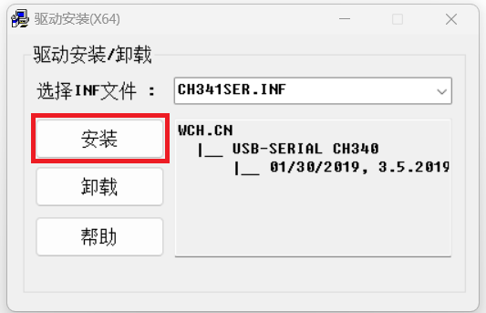
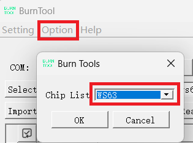
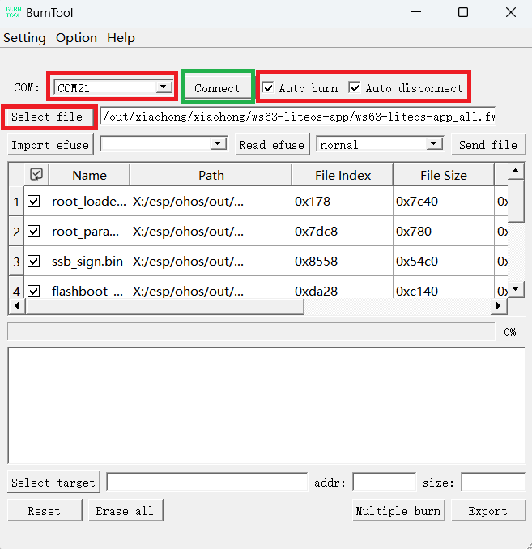

# 小鸿SE (xiaohong-se)

## 项目介绍

开发环境的搭建、拉取代码、编译项目代码的详细步骤，见：[README_CN.md](../README_CN.md)

**注意：**

> 小鸿SE开发板上右端的 "TTL" 丝印下方的Type-C口，是用于开发板供电、调试和烧录固件用的，并且是板上的ESP32-P4芯片和WS63芯片复用的，可以通过开发板左下角的 "P4/WS63" 按键进行切换：
>
> "P4/WS63" 按键弹起：点亮上方的P4蓝色指示灯，表示当前"TTL"  Type-C口连接ESP32-P4芯片，可以对ESP32-P4芯片进行调试和烧录固件。
>
> "P4/WS63" 按键压下：点亮上方的WS63蓝色指示灯，表示当前"TTL"  Type-C口连接WS63芯片，可以对WS63芯片进行调试和烧录固件。

## 固件路径

```
# 编译小鸿项目，生成的固件在
//out/xiaohong/xiaohong-se/ws63-liteos-app/ws63-liteos-app_all.fwpkg
```

## 烧录固件

先去 https://pan.baidu.com/s/5sVfap2wmaGsovWxKS66tpA 下载两个工具（都是在Window系统运行的工具）：

> 1.CH341_USB转串口Windows_Linux驱动程序.rar
>
> 2.Hi3863BurnTool_5.0.39_windows.rar

### 1. 安装 CH341_USB 串口工具驱动

解压 "1.CH341_USB转串口Windows_Linux驱动程序.rar" 到本地，以管理员身份运行其中的"CH341SER.EXE"文件，安装串口驱动程序，如下图所示。



### 2. 安装 Hi3863BurnTool 烧录工具

解压"2.Hi3863BurnTool_5.0.39_windows.rar"到本地即可，该烧录工具是免安装的。

### 3. 烧录固件主板上的WS63芯片的固件

先用Type-C数据线连接PC与小鸿SE设备右边测上的 “TTL” 接口。

按下开发板左下角的 "ON/OFF" 按键，整机开机，点亮 Power 红色指示灯。

按下开发板左下角的 "P4/WS63" 按键，点亮WS63蓝色指示灯（表示当前"TTL"  Type-C口连接WS63芯片，可以对WS63芯片进行调试和烧录固件）。

以管理员身份运行步骤2中解压出来的 “BurnTool.exe” 可执行文件，在打开的烧录软件界面，菜单上的 “Option”选项下的 “Change Chip” 选项下，确认选中 “ WS63 ”。



烧录工具会自动检测到小鸿设备连接的COM口，如果检测到多个COM口有设备接入，请在COM标签的下拉菜单选择待烧录的小鸿设备接入的COM口。



勾选 ”Auto burn“ 和 ”Auto disconnect“，点击 ”Select file“ ，选择待烧录的固件（//out/xiaohong/xiaohong-se/ws63-liteos-app/ws63-liteos-app_all.fwpkg）。

点击 ”Connect“ 按钮，中间的提示框出现 “Connecting...” 字样时，**按下开发板左下角的 "WS63/RESET" 按键**，即可对WS63芯片进行复位，自动启动烧录过程。

烧录完成后，WS63芯片会会自动重启并运行。

建议通过左下角的 "ON/OFF" 按键，对整块开发板进行断电，再上电，确保整机重启，进入正常工作状态。

### 4. 烧录独立模块的WS63芯片的固件

烧录小鸿SE的独立模块的固件，操作步骤基本上与上面的步骤一致，只是最后一步稍有不同：

> 点击 ”Connect“ 按钮，中间的提示框出现 “Connecting...” 字样时，**按下模块的RESET按键**，即可对模块上的WS63芯片进行复位，自动启动烧录过程。


## 配套模块

小鸿SE配套的一组独立模块，每个模块都有自己的独立的功能代码，一般是运行 //vendor/atomgit/xiaohong-se/examples/ 目录下的示例代码。

以在**某个独立的模块**上运行 //vendor/atomgit/xiaohong-se/examples/00_helloworld/ 示例程序为例，编译时，需要修改如下配置：

1. 修改 //vendor/atomgit/xiaohong-se/examples/BUILD.gn 文件的配置：

   ```
   lite_component("demos") {
     features = [
       "00_helloworld:helloworld",  # 编译这个，就打开它
     ]
   }
   ```
   

   
2. 修改 //device/soc/hisilicon/ws63v100/sdkv106/build/config/target_config/ws63/config.py 文件，在 'ws63-liteos-app' 的 'ram_component' 中找到这个片段（在100行左右）：

   ```
               "hal_iothardware", "wifiservice",
       "lvgl",
       "opus",
   #   "xiaohong",    # 独立的模块，不需要运行xiaohong对话的agent程序，需注释掉。
       "helloworld",  # 独立的模块，运行哪个示例程序，就把对应示例程序的 static_library("helloworld") 名字放到这里
       ],
   ```

   

3. 修改 //device/soc/hisilicon/ws63v100/sdkv106/libs_url/ws63/cmake/ohos.cmake 文件，在 MATCHES "ws63-liteos-app" 的列表中找到如下片段：

   ```
           "samgr" "samgr_adapter" "samgr_source"
           "hal_iothardware" "wifiservice"
   
   #   "xiaohong"    # 独立的模块，不需要运行xiaohong对话的agent程序，需注释掉。
       "helloworld"  # 独立的模块，运行哪个示例程序，就把对应示例程序的 static_library("helloworld") 名字放到这里
   # 跟上面的 config.py 文件中的基本一致，不带逗号
           )
   ```

   

   然后就按照 "编译代码" 的说明，执行 **hb build -f** 命令编译出固件，将生成的固件烧录到独立的模块中去即可。

   

   如果在**主板的WS63**上，既运行小鸿AI的Agent对话程序，也想同时运行 //vendor/atomgit/xiaohong-se/examples/00_helloworld/ 示例程序，编译时，在上面的 2/3 两处修改中，打开 "xiaohong"，让它一起编译进固件中。再将生成的固件烧录到主板的WS63上即可。这个场景基本上是：

   ```
主板上的WS63，运行小鸿AI的Agent对话程序 + 一个星闪Server程序；
   独立的模块，单独运行一个星闪Client程序；
两者之间就可以通过星闪进行组网和通信了。
   ```

   
