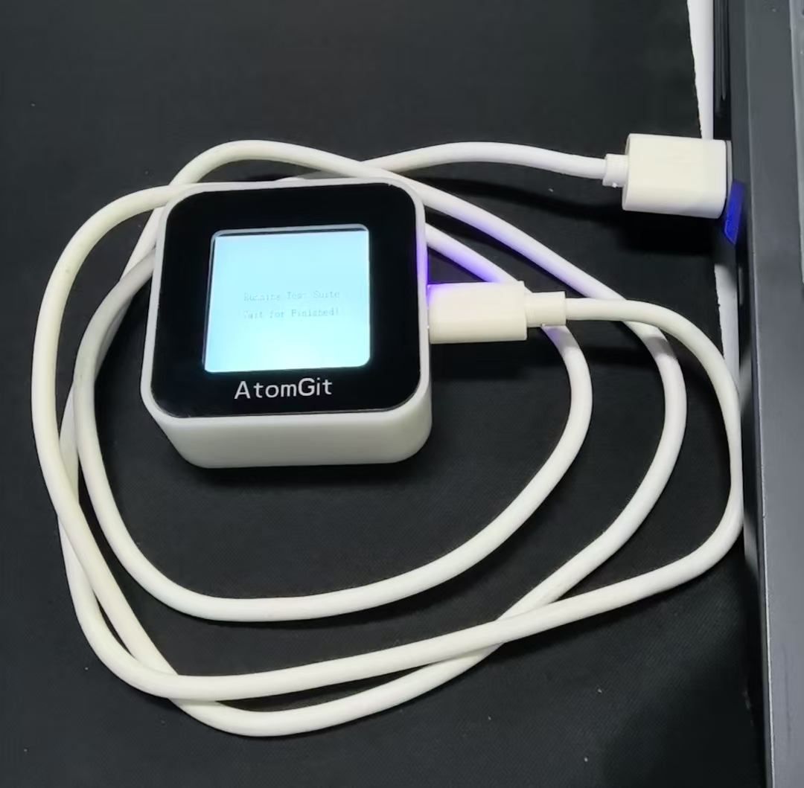

# 小鸿 AI (xiaohong)

## 项目介绍

开发环境的搭建、拉取代码、编译项目代码的详细步骤，见：[README_CN.md](../README_CN.md)


## 固件路径

```
# 编译小鸿项目，生成的固件在
//out/xiaohong/xiaohong/ws63-liteos-app/ws63-liteos-app_all.fwpkg
```

## 烧录固件

先去 https://pan.baidu.com/s/5sVfap2wmaGsovWxKS66tpA 下载两个工具（都是在Window系统运行的工具）：

> 1.CH341_USB转串口Windows_Linux驱动程序.rar
>
> 2.Hi3863BurnTool_5.0.39_windows.rar

### 1. 安装 CH341_USB 串口工具驱动

解压 "1.CH341_USB转串口Windows_Linux驱动程序.rar" 到本地，以管理员身份运行其中的"CH341SER.EXE"文件，安装串口驱动程序，如下图所示。


### 2. 安装 Hi3863BurnTool 烧录工具

解压"2.Hi3863BurnTool_5.0.39_windows.rar"到本地即可，该烧录工具是免安装的。

### 3. 烧录固件

先用Type-C数据线连接PC与小鸿设备。设备左边的拨码开关向下拨动，整机开机。




以管理员身份运行步骤2中解压出来的 “BurnTool.exe” 可执行文件，在打开的烧录软件界面，菜单上的 “Option”选项下的 “Change Chip” 选项下，确认选中 “ WS63 ”。


烧录工具会自动检测到小鸿设备连接的COM口，如果检测到多个COM口有设备接入，请在COM标签的下拉菜单选择待烧录的小鸿设备接入的COM口。


勾选 ”Auto burn“ 和 ”Auto disconnect“，点击 ”Select file“ ，选择待烧录的固件（//out/xiaohong/xiaohong/ws63-liteos-app/ws63-liteos-app_all.fwpkg）。

点击 ”Connect“ 按钮，中间的提示框出现 “Connecting...” 字样时，**同时按下小鸿设备正上方的左右两个按键**（音量加和音量减键，按键不分先后顺序）**然后松开**，即可对WS63芯片进行复位，自动启动烧录过程。

烧录完成后，设备会会自动重启并运行。